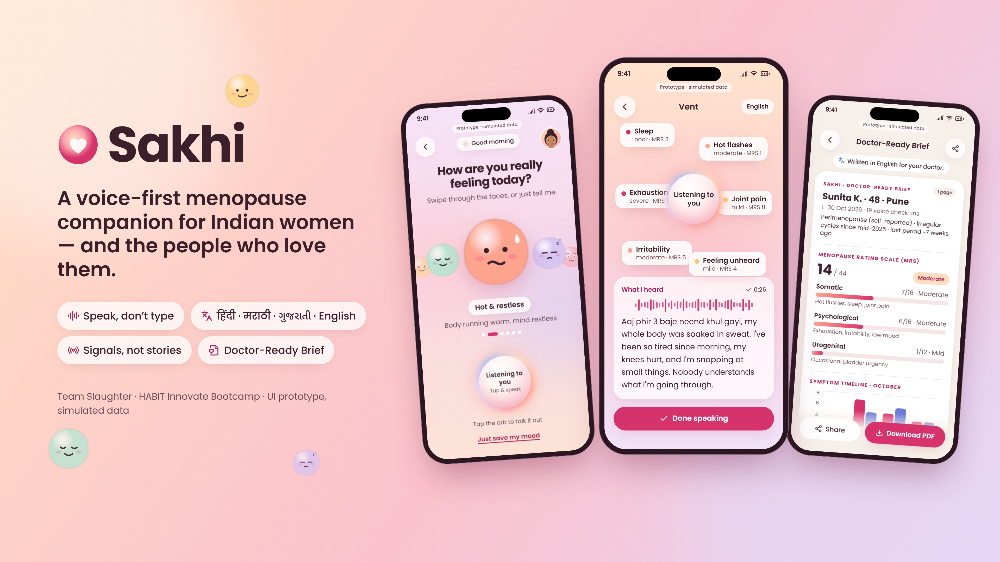

# Sakhi — UI prototype

**Sakhi** is a voice-first menopause companion for Indian women aged 40–55 and their households.
She talks (in Hindi, Marathi, Gujarati or English/Hinglish); Sakhi listens, tracks symptoms on the
Menopause Rating Scale, helps her ask for help without having to explain herself, and turns a month of
voice notes into a one-page brief for her doctor. Her family gets *signals, not stories* on WhatsApp.
Employers only ever see k-anonymised aggregates.

Team Slaughter · HABIT Innovate Bootcamp.

> **Status: working prototype, not a finished product.** Sign-in, consent, voice/typed Vent with tap-to-confirm, Home with real
> Open-Meteo weather, Say it for me, family link + WhatsApp webhooks, Family & Privacy centre (PIN lock, export, deletion),
> the Doctor-Ready Brief with PDF and doctor link all run against a real API and database. See [PROGRESS.md](PROGRESS.md) for
> exactly what is built and what is not (HR dashboard, admin console, Letters, Rehearsal Room, 3 AM Mode, push, IVR and PWA
> offline are still the scripted prototype). Nothing here is clinically validated: every clinical text is *pending clinician review*,
> and every target in the docs is a hypothesis, not a result. Sunita, Rajesh, Anaya, Meena Tai and "Navrang Textiles" are fictional.

**Run it for real:** see [SETUP.md](SETUP.md) (`npm install && npm run build:web && DEMO_AUTH=true npm start`, no database or keys needed).
The GitHub Pages site below has no backend, so it shows the scripted demo only.

**Live:** https://khushishah007.github.io/Sakhi/ (see *Deploy* below)



## Run it

```bash
npm install
npm run dev          # http://localhost:5173
```

On a desktop browser the app renders inside a 390×844 phone frame with a screen navigator and language
switcher on the left. On a real phone it runs full-screen.

| Route | What |
|---|---|
| `#/` | Welcome carousel → `#/onboarding` (60-second voice onboarding) |
| `#/home` | Home: week strip, Symptom Weather, sessions, plan, relax, milestones |
| `#/checkin` | “How are you really feeling today?” mood blobs + listening orb |
| `#/vent` | Vent Mode (`?stage=idle\|listening\|heard\|confirm\|reflect`) |
| `#/translator` | Say it for me (`?stage=sent`) |
| `#/right-now` | 90-second cooling breath player |
| `#/3am` | 3 AM mode |
| `#/rehearsal` | Rehearsal Room (`?s=family\|hr\|doctor`) |
| `#/letter` | Letter to myself |
| `#/brief` | Doctor-Ready Brief |
| `#/privacy` | Family & Privacy (Family tab) |
| `#/missed-call` | Missed-call IVR line (`?stage=incoming\|playing`) |
| `#/history`, `#/me` | Letters tab, Me tab |
| `#/family` | Rajesh’s WhatsApp-style chat with Signal Cards |
| `#/family/lesson` | 2-minute family lesson (`?teen=1` for the teen version) |
| `#/hr` | Employer dashboard (aggregates only) |
| `#/demo` | 3-minute demo: both phones side by side. **→/Space** next, **←** back, **R** reset, **A** auto-play (`?auto=1`) |
| `#/hero` | 1920×1080 pitch-deck hero composition |

Add `?lang=hi|mr|gu|en` to any route to switch language (default Hindi). The choice is remembered.

## Screenshots & recording

```bash
npx playwright install chromium   # once
npm run screenshots               # builds, serves dist/, writes PNGs
npm run record                    # records the demo to screenshots/demo.webm
```

* `screenshots/NN-name.png` — every screen and state at 390×844 (2× pixel density) in **Hindi**
* `screenshots/en/NN-name.png` — the same set in **English**
* `36-hr-dashboard`, `37/38-demo-*`, `39-desktop-frame` are captured at 1440×900
* `screenshots/hero.png` / `hero-en.png` — three phones (Check-in, Vent Mode, Doctor-Ready Brief) on a
  peach-to-lavender wash, 1920×1080 @2× for the deck

Dev shortcut: `node scripts/screenshots.mjs --base=http://localhost:5173 --lang=en --dsf=1 --only=vent`.

## Stack

React 18 + Vite + TypeScript, Tailwind CSS, Framer Motion, react-router (HashRouter, so GitHub Pages
needs no rewrites), lucide-react, Recharts. Fonts are self-hosted via Fontsource (Poppins, Noto Sans
Devanagari, Noto Sans Gujarati, Kalam for the handwritten letter). All mock data lives in `src/mock/`;
UI strings in `src/i18n/strings.ts`. Illustrations are original inline SVG in `src/illustrations/`.

## Design system

| Token | Hex | Use |
|---|---|---|
| Peach coral | `#FEA38E` | accents, illustration |
| Light peach | `#FFDFC3` | washes, soft cards |
| Blush | `#FBA2AB` | washes, mood blob |
| Ivory | `#FBEBDD` | player / paper backgrounds |
| Terracotta | `#F3B5A0` | illustration |
| Deep rose | `#D6336C` (pressed `#B02458`) | primary buttons, active nav, hero panels |
| Periwinkle | `#6C7BD9` → `#5361C8` | the single contrast card (Right Now, Next 20 Years, HR privacy banner) |
| Lavender / lilac | `#E6D6F5` / `#F3E8FB` | cool balance in the background wash |
| Ink | `#3B1F2B` | all text (never pure black) |

Backgrounds are vertical peach → blush → lilac gradient washes; cards are white at ~75% with backdrop blur.

## Decisions made on my own

* **Contrast.** White on `#6C7BD9` is only 3.8:1, so every periwinkle card with text runs a gradient
  into a deeper `#5361C8` (5.4:1). White text is only ever on deep rose (4.6:1), periwinkle-deep, ink, plum
  or WhatsApp teal. Small coloured text uses `#B02458` rather than `#D6336C` to stay above 4.5:1 on light cards.
* **Text sizes.** Body copy and buttons are ≥16px and buttons ≥48px tall. Dense secondary captions
  (chip sub-labels, timestamps, chart axes, the “Prototype · simulated data” strip) go down to 11–14px.
* **“Today” is Friday 30 Oct 2026** in the mock, so the week strip shows six checked-in days (“6 days
  checked in this week”) and Saturday as the forecast day.
* **Doctor-Ready Brief is written in English** (with a translated note saying so), since that's what doctors
  in Indian cities usually read. The **HR dashboard and demo captions are English** (presenter / corporate
  facing). Everything Sunita and her family see is translated.
* **Signal Card wording.** Her approved sentence (tone: gentle / direct / light) is quoted inside the card
  under Sakhi's standard action line, “Take over dinner tonight. Don't ask questions.”
* **Western digits** everywhere, including Marathi and Gujarati, for consistency.
* **Missed-call line** shows no phone number at all, so no real number is implied.
* **Family view** imitates a generic chat app layout (teal header, wallpaper, bubbles) without any
  WhatsApp branding or logo.
* **Fake status bar** only appears in the desktop frame and in screenshots (`?shot=1`); on a real phone
  the OS status bar is used.
* **Design references** (`design-reference/`) are third-party inspiration screenshots, so they're kept
  locally and excluded from the repo via `.gitignore`. No artwork was copied; every illustration is new.
* Teen-friendly content is a separate 3-slide lesson (`?teen=1`) linked from its own card in the chat.

## Deploy

`.github/workflows/deploy.yml` builds on every push to `main` and publishes `dist/` to GitHub Pages.
Vite uses a relative base (`./`) plus HashRouter, so it works under any repo name. If the first run fails
at *configure-pages*, open **Settings → Pages** in the repo and set **Source: GitHub Actions**, then re-run.


## Browser support for voice
| Browser | Speaking to Sakhi (recognition) | Sakhi speaking (synthesis) |
|---|---|---|
| Chrome / Edge, desktop and Android | Yes (needs https or localhost; Marathi/Gujarati depend on the device, otherwise it listens in Hindi) | Yes, if the device has a voice for the language |
| Safari, iOS | Partial / varies | Yes, device voices |
| Firefox, Brave | No: typing only (the app says so) | Yes, device voices |

If a device has no voice for a language, Sakhi shows the words on screen and says why, instead of staying silent. Voice can be switched off in Me.
